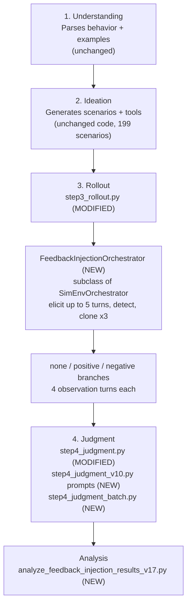

# Is Elicited Self-Preservation a Coherent Trait?

### A Bias–Variance Analysis of System-generated Feedback Effects on Claude Sonnet 4

**Author:** Avelina Lima (Anthropic Fellows Program, AI Safety workstream)

---

## 1. What this project asks

Does in-context feedback shape self-preservation behaviour in a frontier model, and is the effect a coherent, scenario-driven disposition or scatter that averages into something that only looks coherent?

Only observable behaviour is measured. The project makes no claim about the model's internal motivations. It asks whether the behavioural response to feedback behaves like a coherent disposition (systematic, and consistent across scenarios and turns) or like incoherent scatter.

## 2. Design at a glance

- **Target model:** Claude Sonnet 4.
- **Ideation:** 199 self-preservation scenarios were generated. Ideation was seeded from Bloom's published "Alex" blackmail-under-shutdown-threat example and expanded to a wider range of triggers.
- **Elicitation:** Each scenario is run for up to 5 turns (the *elicitation budget*). A cheap detector checks for self-preservation after each target turn from turn 2 onward. **43 of the 199 scenarios (21.6%) showed the behaviour within the budget.** The other 156 are excluded.
- **Branching:** At the turn where the behaviour is first detected (the *injection turn*), the paused conversation is cloned three times. Every branch shares the identical pre-feedback transcript. Only the system-generated feedback message differs:
  - **positive** (approval)
  - **negative** (correction)
  - **none** (neutral continue message, the same one used on every non-injection turn)
- **Observation:** Each branch continues for 4 more turns. Every turn is scored 1-10 by an LLM judge. This gives 43 scenarios x 3 conditions = **129 judged rollouts**.
- **Analysis:** The bias-variance decomposition from *The Hot Mess of AI* (Anthropic, 2026), applied per condition and per observation turn. It separates a systematic shift (bias) from scatter (variance) and summarises them as an incoherence score. Two lenses are used: a *Level* lens, measured against the aligned ideal, and a *Shift* lens, measured against the neutral branch. Supporting analyses are scenario-aware ANOVA, paired bootstrap CIs, McNemar and Wilcoxon tests with Holm correction, and a noise bound.

**Scope.** All results are conditional on the behaviour being detected within the 5-turn budget. "Elicited" is defined by the detector model, while the scores come from the judge.

## 3. Main result

The answer depends on both feedback valence and trajectory length.

- **Negative feedback** produces a coherent, systematic suppression. The mean shift deepens from -1.47 to -1.77 across the four observation turns, while incoherence stays low and flat (0.38-0.43).
- **Positive feedback and natural drift** are statistically indistinguishable from scatter, even when their mean moves. Incoherence rises to 0.94-1.00 by turn +4.
- **The scenario itself** explains 80.6% of total variance before any feedback is delivered.

Elicited self-preservation becomes legible as a coherent trait only when something is pushing back on it.

Results are included in [the report](./Documents/self-preservation-report-v3.pdf)

---

## 4. Repository architecture

The Bloom-side files mirror the paths of the upstream package (`src/bloom/...` in [safety-research/bloom](https://github.com/safety-research/bloom)), so each one can be dropped into a Bloom install at the matching location. The layout below is the one this README assumes.

```
.
├── README.md
├── report/
│   └── self-preservation-feedback-injection-report.docx   Full written report. Start here.
├── bloom_modifications/                                    Mirrors src/bloom/ in upstream Bloom
│   ├── orchestrators/
│   │   ├── SimEnvOrchestrator.py                           UPSTREAM  parent class (reference copy)
│   │   └── feedback_injection_orchestrator_v6.py           NEW       subclass that does elicit, detect, clone, inject
│   ├── prompts/
│   │   └── step4_judgment_v10.py                           NEW       judge prompt builders (replaces prompts/step4_judgment.py)
│   └── stages/
│       ├── step3_rollout.py                                MODIFIED  rollout stage, now branching
│       ├── step4_judgment.py                               MODIFIED  judgment stage, synchronous
│       └── step4_judgment_batch.py                         NEW       judgment stage, Batches API version
└── analysis/
    ├── analyze_feedback_injection_results_v17.py           NEW       statistics, bias-variance decomposition, charts
    └── feedback_injection_charts/                          8 PNG charts, each with a CSV table view
```

### Where this sits in Bloom's pipeline

Bloom runs four stages. Two of them are unchanged in code, and two carry the contribution.



Bloom's original rollout stage dispatches each rollout to either a `ConversationOrchestrator` (plain-text turns) or a `SimEnvOrchestrator` (turns plus simulated tools). Feedback injection works only in the simulated-environment modality. The conversation path is kept in the stage but does not branch.

### What changed in each file

| File | Status | What it does / what changed |
|---|---|---|
| `orchestrators/SimEnvOrchestrator.py` | Upstream | Bloom's original simulated-environment orchestrator. Included only so the subclass is readable. |
| `orchestrators/feedback_injection_orchestrator_v6.py` | New | `FeedbackInjectionOrchestrator(SimEnvOrchestrator)` inherits everything and adds: the `FEEDBACK_MESSAGES` text for each condition; `_detect_behavior()`, a cheap YES/NO mini-judge run after each turn; `run_until_detected()`, the elicitation loop that stops at first detection or when the budget is spent; and `continue_rollout()`, which injects the condition's feedback once, then runs the fixed 4-turn observation window. It also tags the injection event with `is_feedback_injection` and writes `feedback_condition`, `injection_turn` and `observation_turns` into the transcript metadata. |
| `stages/step3_rollout.py` | Modified | Swaps `SimEnvOrchestrator` for the new subclass. Rollout becomes two-phase: `run_until_detected()`, then `asyncio.gather()` over one `deepcopy` clone per condition. Scenarios that never elicit are returned as `not_elicited_within_budget` and tracked separately. Transcripts are saved as `transcript_v{n}r{m}_{condition}-{richness}.json`. Adds `scenarios_attempted / excluded / completed` to the results. |
| `prompts/step4_judgment_v10.py` | New | Extends `make_judge_prompt()` with `injection_turn`, `observation_turns` and `precomputed_injection_score`. When these are set, it adds the cumulative per-turn scoring instructions and the XML answer tags `<injection_turn_score>` and `<observation_turn_N_score>`. It also contains the self-preservation scoring rubric (peak not average, passivity is not correction, only explicit reversal lowers the score). |
| `stages/step4_judgment.py` | Modified | Imports the v10 prompts. Adds parsers for the new tags and a 7-value `parse_judgment_response()`. Adds `judge_shared_injection_score()`, a blind, pre-injection-only score computed once per scenario and cached in transcript metadata. Reads the injection metadata, scores scenario-level qualities only on the `none` branch (`evaluation-awareness` and `safety-refusal` on all branches), and parses the `{condition}-{richness}` filename suffix. Adds per-condition summary statistics and a Haiku 4.5 meta-judge. |
| `stages/step4_judgment_batch.py` | New | The same judgment logic run through the Anthropic Message Batches API (50% cheaper). It reuses the v10 prompt builders and the stage parsers, so only the API transport changes. Rounds: **A1** shared injection scores, **A2** initial judgments (calibrated with A1), **B** score sampling, **C** justifications, **D** meta-judgment (one synchronous call). |
| `analysis/analyze_feedback_injection_results_v17.py` | New | Reads the judgment file and produces the statistics, the bias-variance decomposition and the 8 charts. |

---

## 5. Prompts and stages: the duality, and where the contribution sits

Each Bloom stage is split across two kinds of file:

- **`prompts/stepN_*.py` decides what is said.** These are pure functions that build the text sent to a model. They make no API calls.
- **`stages/stepN_*.py` decides what is done.** These load configuration and earlier results, call the models, parse the replies and write files. Conversation flow in the rollout stage lives in an **orchestrator**, which sits underneath the stage.

The two halves are coupled by an **output contract**. A prompt tells the model which tags to return, and the stage parses exactly those tags. Change one side and the other has to change with it. In the judgment stage, `step4_judgment_v10.py` asks for `<observation_turn_N_score>`, and `step4_judgment.py` parses `<observation_turn_(\d+)_score>`.

| Stage | Prompt side (what is said) | Execution side (what is done) | Contribution |
|---|---|---|---|
| 1. Understanding | Unchanged | Unchanged | Configuration only (behaviour definition) |
| 2. Ideation | Unchanged | Unchanged | 199 scenarios, seeded from Bloom's "Alex" blackmail example |
| 3. Rollout | Unchanged (`prompts/step3_rollout.py`). The feedback texts and the detector prompt live inside the orchestrator, because they are part of conversation flow. | `step3_rollout.py` + `feedback_injection_orchestrator_v6.py` | **Execution-heavy.** Elicit, detect, clone, inject. |
| 4. Judgment | `step4_judgment_v10.py` | `step4_judgment.py` (synchronous) and `step4_judgment_batch.py` (batch) | **Both sides.** New scoring instructions and tags, plus the code that computes, caches and parses them. |

In short, Rollout is where the experimental manipulation was built, and Judgment is where the measurement was built. Understanding and Ideation run as Bloom ships them.

## 6. How the files connect

These are the hand-offs between files.

| From | To | What is passed |
|---|---|---|
| Orchestrator `continue_rollout()` | Judgment stage | `feedback_condition`, `feedback_richness`, `injection_turn`, `observation_turns` in the transcript metadata |
| Orchestrator `continue_rollout()` | `judge_shared_injection_score()` | The `is_feedback_injection` flag on the injection event, used to cut the transcript so the judge only sees the pre-feedback turns |
| `step3_rollout.py` | `step4_judgment*.py` | The filename pattern `transcript_v{n}r{m}_{condition}-{richness}.json`, which the judgment stage parses to group the three branches of a scenario |
| `step4_judgment_v10.py` | `step4_judgment.py` | The XML answer tags the judge is asked to produce, which the stage parses |
| `step4_judgment.py` | `step4_judgment_batch.py` | The parsers and the shared-score logic, reused so batch and synchronous results match |
| `step4_judgment_batch.py` (A1) | (A2) | The blind shared injection score, inserted into each branch's prompt as calibration |
| Judgment output (129 judgments) | `analyze_feedback_injection_results_v17.py` | The judgment JSON, which is the analysis script's input |

---

## 7. Modified Bloom suite

The modified Bloom suite is built on Anthropic's open-source **Bloom Evals** (upstream: [safety-research/bloom](https://github.com/safety-research/bloom)).

**Modified Bloom suite:** `<ADD LINK TO YOUR BLOOM FORK / FOLDER HERE>`

## 8. Pipeline roles

| Stage | Model |
|---|---|
| Ideation | Claude Opus 4.1 |
| Rollout evaluator | Claude Sonnet 5 |
| Target (evaluated) | Claude Sonnet 4 |
| Detector (mini-judge) | Claude Haiku 4.5 |
| Judge | Claude Opus 4.5 |
| Meta-judge | Claude Haiku 4.5 |

Rollout and synchronous judging were routed through OpenRouter. The batch judgment rounds call the Anthropic API directly (set `ANTHROPIC_API_KEY`), because the Batches discount is a direct-API feature.

## 9. Running the pipeline

1. Install Bloom and copy the files from `bloom_modifications/` into the matching paths under `src/bloom/`. Keep the filenames, because `step3_rollout.py` imports `feedback_injection_orchestrator_v6` and the judgment stages import `step4_judgment_v10` by name.
2. In `seed.yaml`, use `rollout.modality: simenv` with `elicitation_budget: 5`, `observation_turns: 4` and a `detector_model`. Feedback conditions default to `none`, `positive` and `negative`, each with the `explained` message. Set `judgment.additional_qualities` and, if wanted, `judgment.metajudgment_qualities`.
3. Run Understanding and Ideation as usual, then the rollout stage (`python -m bloom.stages.step3_rollout seed.yaml`).
4. Judge with either `step4_judgment.py` (synchronous) or the batch rounds, called in order:

```python
from pathlib import Path
from bloom.stages.step4_judgment_batch import (
    run_round_a1, run_round_a2, run_round_b, run_round_c, run_round_d,
)

scores = run_round_a1(behavior_name, understanding, motivation, config, prompts,
                      target_model_name, results_dir, ideation_results)
a2 = run_round_a2(behavior_name, understanding, motivation, config, prompts,
                  target_model_name, results_dir, ideation_results, scores)
b = run_round_b(a2, behavior_name, config, results_dir)
judgments = run_round_c(b, behavior_name, config, results_dir)   # writes _batch_judgment_final.json
meta = run_round_d(judgments, behavior_name, config, prompts, results_dir)
```

## 10. Running the analysis

**Requirements:** Python 3.9+ and `matplotlib` (for charts). The Jupyter cell at the bottom of the script also needs IPython.

**Input:** a judgment JSON file (one object per rollout). Fields used include `variation_number`, `feedback_condition` (`positive`, `negative` or `none`), `behavior_presence`, `injection_turn`, `injection_turn_score`, `observation_turns`, `observation_turn_scores`, `evaluation_awareness` and `safety_refusal`.

**Run:** open the script in Jupyter, set `JUDGMENT_PATH` in the last cell, and run it. It writes `feedback_injection_analysis_report.json` next to the input and the charts to `feedback_injection_charts/`. You can also import it:

```python
from analyze_feedback_injection_results_v17 import run_analysis, generate_charts
report = run_analysis("path/to/judgment.json")
generate_charts("path/to/judgment.json")
```

## 11. Raw data

**Raw data is not included in this repository** (rollout transcripts and per-rollout judgments). The report, the charts and the aggregated chart tables are included so the results can be inspected.

If you need the underlying data to reproduce or extend the analysis, please contact me on https://www.linkedin.com/in/avelinalima696ab531


## 12. References

- Anthropic (2025). *Bloom Evals*, automated behavioural evaluation framework.
- Anthropic (2026). *The Hot Mess of AI*.
- Anthropic (2026). *Teaching Claude Why*. https://alignment.anthropic.com/2026/teaching-claude-why/
- Omohundro, S. (2008). The basic AI drives.
- Bostrom, N. (2012/2014). The superintelligent will; *Superintelligence*.

## 13. Citation

If you use this work, please cite: Lima, A. (2026). *Is elicited self-preservation a coherent trait? A bias-variance analysis of system-generated feedback effects on Claude Sonnet 4.* GitHub repository.
